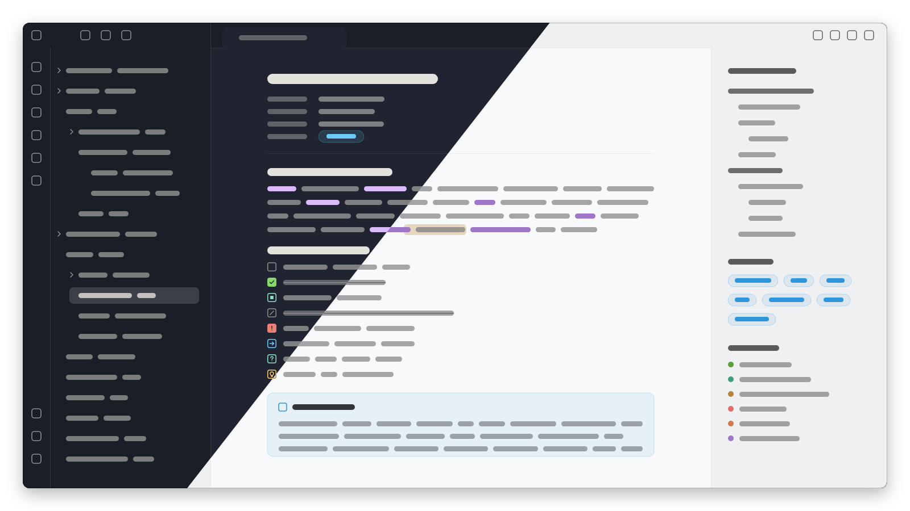

# Ayu Simple

An Obsidian theme in the Ayu colourway: Ayu Light for the light scheme and Ayu Mirage for the dark, from their iTerm2 schemes ([iTerm2-Color-Schemes](https://github.com/mbadolato/iTerm2-Color-Schemes)). Colours follow [Ta Da Swift](https://github.com/lobrenov/ta-da-swift)'s Ayu theming and work well with the [Ta Da plugin](https://github.com/lobrenov/ta-da-obsidian) or standalone.

## Colours

| Role | Light | Mirage | Obsidian variable |
| --- | --- | --- | --- |
| Background | `#f8f9fa` | `#1f2430` | `--background-primary` |
| Sidebar | `#eff0f1` | `#191e27` | `--background-secondary` |
| Selection, active item | `#dfe1e2` | `#3b3f47` | `--text-selection`, `--background-modifier-border-hover` |
| Hairlines | `#e8eaeb` | `#30353f` | `--background-modifier-border` |
| Code, inputs | `#f0f1f3` | `#282c37` | `--background-primary-alt`, `--code-background` |
| Body text | `#5c6166` | `#cccac2` | `--text-normal` |
| Headings, code text | `#333538` | `#e3e2dd` | `--h1-color`…`--h5-color`, `--code-normal` |
| Muted | `#686868` | `#8e8e8d` | `--text-muted` |
| Accent | `#3096dc` | `#6dcbfa` | `--accent-h/s/l`, `--color-blue` |
| Due | `#b88435` | `#facc6e` | `--color-yellow` |
| Deadline | `#e56a6b` | `#ed8274` | `--color-red` |
| Done | `#5ba038` | `#87d96c` | `--color-green` |
| Doing | `#3ca07f` | `#90e1c6` | `--color-cyan` |
| Blocked | `#cf794d` | `#f3a771` | `--color-orange` |
| Links | `#9e75c7` | `#dabafa` | `--color-purple`, `--link-color` |

A user accent colour set in Obsidian's Appearance settings replaces the theme's.

## Checkboxes

Every marker in the [Alternative Checkboxes Reference Set](https://github.com/damiankorcz/Alternative-Checkboxes-Reference-Set) draws as a rounded box with a glyph, in Reading view and Live Preview:

| Syntax | Name | Colour | Syntax | Name | Colour |
| --- | --- | --- | --- | --- | --- |
| `[ ]` | Not started | Muted | `[l]` | Location | Links |
| `[x]` | Done (filled) | Done | `[b]` | Bookmark | Blocked |
| `[/]` | Doing | Doing | `[i]` | Information | Accent |
| `[-]` | Cancelled | Muted | `[S]` | Savings | Done |
| `[>]` | Forwarded | Accent | `[I]` | Idea | Due |
| `[<]` | Scheduling | Due | `[p]` | Pros | Done |
| `[?]` | Question | Doing | `[c]` | Cons | Deadline |
| `[!]` | Important (filled) | Deadline | `[f]` | Fire | Blocked |
| `[*]` | Star | Due | `[k]` | Key | Due |
| `["]` | Quote | Muted | `[w]` | Win | Due |
| `[u]` | Up | Done | `[d]` | Down | Deadline |

Done and Cancelled strike their text through in muted.

## Markdown

- Inline code: `code` background with a hairline ring, heading-coloured text. Code blocks: 10px corners with the same ring.
- Highlights: due at 30% (26% on Mirage), heading-coloured text.
- Tags: accent text on accent at 10% (14%), with a 28% (32%) ring.
- Callouts: the type's colour at 9% (14%) with a 24% (30%) ring, heading-coloured titles. Question callouts use due; quote callouts use muted.
- Quotes: muted text beside a 3px bar.
- Monospace: JetBrains Mono, then SF Mono and Menlo.

## Install

Copy `manifest.json` and `theme.css` into `<vault>/.obsidian/themes/Ayu Simple/`, then choose Ayu Simple in Settings → Appearance → Themes.

## Licence

MIT (`LICENSE`).
